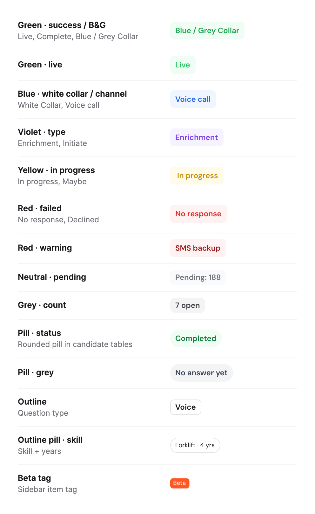

**Used in:** Desktop (71 of 80 screens)

The screens use **soft, colour-coded badges** (light background, darker text of the same colour), not the shadcn defaults. The colour tells the user what kind of information it is.

<Frame caption="Real badges from the desktop screens">
  
</Frame>

## Tones

| Tone | Background | Text | Used for |
| --- | --- | --- | --- |
| `success` | `#F0FDF4` (green-50) | `#16A34A` (green-600) | Live, Complete, WhatsApp, Blue / Grey Collar |
| `info` | `#EFF6FF` (blue-50) | `#2563EB` (blue-600) | White Collar, Voice call |
| `type` | `#F5F3FF` (violet-50) | `#7C3AED` (violet-600) | Enrichment, Initiate, Candidate-led |
| `warning` | `#FEFCE8` (yellow-50) | `#CA8A04` (yellow-600) | In progress, Maybe, Low trust |
| `danger` | `#FEF2F2` (red-50) | `#DC2626` (red-600) | Failed, No response, Declined, SMS backup |
| `pending` | `#F9FAFB` (gray-50) | `#71717A` (zinc-500) | Pending counts |
| `muted` | `#F4F4F5` (zinc-100) | `#3F3F46` (zinc-700) | Counts such as "7 open", Completed, Closed |
| `outline` | transparent, border `#E4E4E7` | `#18181B` | Question type (Voice, Yes / No) |
| `beta` | `#FF5723` | `#FAFAFA` | Beta tag next to a sidebar item |

## Shapes and sizes

| Shape | Radius | Height | Where |
| --- | --- | --- | --- |
| Default | 6px (`rounded-md`) | 28px | Most tables, cards and headers |
| Compact | 6px | 24px | Inside dense cards |
| Pill | `rounded-full` | 28px | Candidate status in candidate tables |
| Skill chip | `rounded-full` | 24px, outline, 12px regular text | "Forklift · 4 yrs" |

Text is 12px semibold.

## Install

```bash
npx shadcn@latest add badge
```

Then replace the variants in `components/ui/badge.tsx`:

```tsx components/ui/badge.tsx
const badgeVariants = cva(
  "inline-flex items-center gap-1 whitespace-nowrap px-2.5 text-xs font-semibold",
  {
    variants: {
      tone: {
        success: "bg-green-50 text-green-600",
        info: "bg-blue-50 text-blue-600",
        type: "bg-violet-50 text-violet-600",
        warning: "bg-yellow-50 text-yellow-600",
        danger: "bg-red-50 text-red-600",
        pending: "bg-gray-50 text-zinc-500",
        muted: "bg-zinc-100 text-zinc-700",
        outline: "border border-input text-foreground",
        beta: "h-4 rounded px-1.5 text-[10px] font-medium bg-primary text-zinc-50",
      },
      shape: {
        default: "h-7 rounded-md",
        compact: "h-6 rounded-md",
        pill: "h-7 rounded-full",
        chip: "h-6 rounded-full font-normal",
      },
    },
    defaultVariants: { tone: "muted", shape: "default" },
  }
)
```

## Usage

```tsx
<Badge tone="success">Live</Badge>
<Badge tone="info">White Collar</Badge>
<Badge tone="type">Enrichment</Badge>
<Badge tone="warning">In progress</Badge>
<Badge tone="danger">No response</Badge>
<Badge tone="pending">Pending: 188</Badge>
<Badge tone="muted" shape="compact">7 open</Badge>
<Badge tone="success" shape="pill">Completed</Badge>
<Badge tone="outline" shape="chip">Forklift · 4 yrs</Badge>
<Badge tone="beta">Beta</Badge>
```

## Which tone to use

- Map each **status** to one tone and keep it the same everywhere: Live and Completed are `success`, In progress is `warning`, Failed is `danger`.
- Use `type` for what something **is** (Enrichment, Initiate), not how it's doing.
- Hiring type: **Blue / Grey Collar** is `success`, **White Collar** is `info`.

<Warning>
  Figma uses slightly different text shades for the same tone in places (for example green-500, -600 and -700). Use the shades in the table above; design should align the frames.
</Warning>
