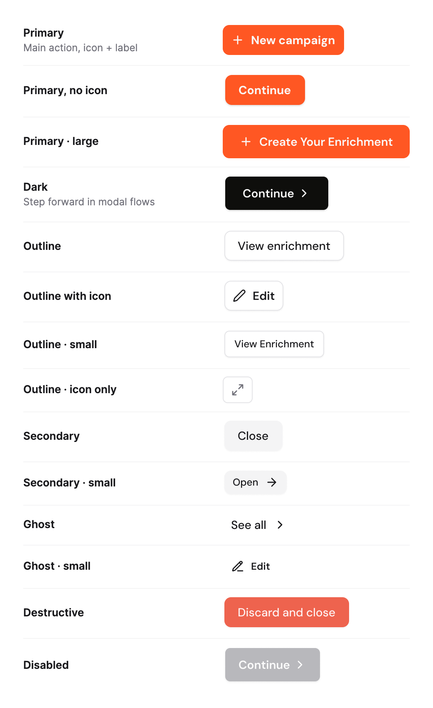
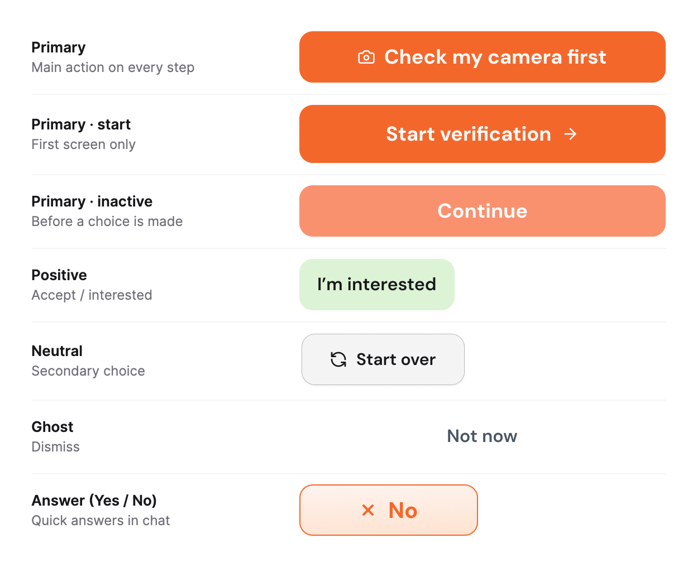

**Used in:** Desktop (76 of 80 screens) · Mobile (48 of 58 screens)

Built on the shadcn/ui Button, but the screens customise it: desktop buttons use **8px corners and bold text**, and mobile has its own larger set. Use the variants below, not the shadcn defaults.

<Tabs>
  <Tab title="Desktop">
    <Frame caption="Real buttons from the desktop screens">
      
    </Frame>

    | Style | `variant` / `size` | Background | Text | Height | Radius |
    | --- | --- | --- | --- | --- | --- |
    | Primary | `default` | `#FF5723` | white, 14px bold | 36px | 8px |
    | Primary · large | `default` / `lg` | `#FF5723` | white, 14px semibold | 40px | 8px |
    | Dark | `dark` | `#0E0E0C` | `#FAFAFA`, 14px semibold | 40px | 6px |
    | Outline | `outline` | white, border `#E4E4E7` | `#18181B`, 14px semibold | 36px | 8px |
    | Outline · small | `outline` / `sm` | white, border `#E4E4E7` | `#18181B`, 12px medium | 32px | 6px |
    | Secondary | `secondary` | `#F4F4F5` | `#18181B`, 14px medium | 36px | 8px |
    | Secondary · small | `secondary` / `sm` | `#F4F4F5` | `#18181B`, 12px medium | 28px | 8px |
    | Ghost | `ghost` | transparent | `#18181B`, 14px medium | 28–36px | 8px |
    | Destructive | `destructive` | `#EE634E` | `#FEF2F2`, 14px medium | 36px | 8px |
    | Disabled | `disabled` | `#71717A` | `#FAFAFA` | as variant | as variant |

    - **Primary** is the main action of the page, usually with a leading icon (`+ New campaign`, `+ New job mandate`).
    - **Dark** moves a modal or multi-step flow forward (`Continue >`).
    - **Outline** is for page-header and card actions (`Edit`, `View enrichment`, `Download`).
    - **Ghost** is for in-card links (`See all >`).
  </Tab>
  <Tab title="Mobile">
    <Frame caption="Real buttons from the mobile screens">
      
    </Frame>

    | Style | `variant` / `size` | Background | Text | Height | Radius |
    | --- | --- | --- | --- | --- | --- |
    | Primary | `default` / `mobile` | `#FF5723` | white, 18px bold | 46px | 12px |
    | Primary · start | `default` / `mobile-lg` | `#FF5723` | white, 18px bold | 52px | 12px |
    | Primary · inactive | `default` / `mobile`, disabled | `#F9916F` | white, 18px bold | 46px | 12px |
    | Positive | `positive` / `mobile` | `#DCF3D5` | `#18181B`, 16px semibold | 46px | 12px |
    | Neutral | `neutral` / `mobile` | `#F4F4F5`, border `#B8B8B8` | `#18181B`, 15px semibold | 46px | 12px |
    | Ghost | `ghost` / `mobile` | transparent | `#4B5563`, 16px semibold | 46px | 12px |
    | Answer (Yes / No) | `answer` / `mobile` | light orange tint, border `#F4672B` | `#F4672B`, 20px bold | 46px | 12px |

    Mobile buttons are full width and sit in the footer of each step.

    <Warning>
      Some mobile primary buttons in Figma use `#F4672B` instead of `#FF5723`. Use `#FF5723` (`bg-primary`) in code; design should align the frames.
    </Warning>
  </Tab>
</Tabs>

## Install

```bash
npx shadcn@latest add button
```

Then replace the variants in `components/ui/button.tsx` with Record's:

```tsx components/ui/button.tsx
const buttonVariants = cva(
  "inline-flex items-center justify-center gap-2 whitespace-nowrap transition-colors disabled:pointer-events-none [&_svg]:size-4 [&_svg]:shrink-0",
  {
    variants: {
      variant: {
        default: "bg-primary text-primary-foreground font-bold hover:bg-primary/90 disabled:bg-zinc-500",
        dark: "bg-[#0E0E0C] text-zinc-50 font-semibold hover:bg-[#0E0E0C]/90",
        outline: "border border-input bg-background text-foreground font-semibold hover:bg-accent",
        secondary: "bg-secondary text-secondary-foreground font-medium hover:bg-secondary/80",
        ghost: "text-foreground font-medium hover:bg-accent",
        destructive: "bg-destructive text-destructive-foreground font-medium hover:bg-destructive/90",
        // mobile
        positive: "bg-[#DCF3D5] text-zinc-900 font-semibold",
        neutral: "border border-[#B8B8B8] bg-zinc-100 text-zinc-900 font-semibold",
        answer: "border border-[#F4672B] bg-[#FFF3EE] text-[#F4672B] font-bold",
      },
      size: {
        sm: "h-8 rounded-md px-3 text-xs",
        default: "h-9 rounded-lg px-4 text-sm",
        lg: "h-10 rounded-lg px-8 text-sm",
        icon: "size-8 rounded-md",
        mobile: "h-[46px] w-full rounded-xl px-4 text-lg",
        "mobile-lg": "h-[52px] w-full rounded-xl px-4 text-lg",
      },
    },
    defaultVariants: { variant: "default", size: "default" },
  }
)
```

<Note>
  The `answer` background is a light orange gradient in Figma. `#FFF3EE` is a flat approximation; confirm with design.
</Note>

## Usage

<CodeGroup>

```tsx Desktop
<Button><Plus /> New campaign</Button>
<Button variant="dark" size="lg">Continue <ChevronRight /></Button>
<Button variant="outline"><Pencil /> Edit</Button>
<Button variant="outline" size="sm">View enrichment</Button>
<Button variant="secondary" size="sm">Open <ArrowRight /></Button>
<Button variant="ghost">See all <ChevronRight /></Button>
<Button variant="destructive">Discard and close</Button>
<Button disabled>Continue</Button>
```

```tsx Mobile
<Button size="mobile"><Camera /> Check my camera first</Button>
<Button size="mobile-lg">Start verification <ArrowRight /></Button>
<Button size="mobile" disabled className="disabled:bg-[#F9916F]">Continue</Button>
<Button variant="positive" size="mobile">I’m interested</Button>
<Button variant="neutral" size="mobile"><RotateCcw /> Start over</Button>
<Button variant="ghost" size="mobile" className="text-gray-600">Not now</Button>
<Button variant="answer" size="mobile"><X /> No</Button>
```

</CodeGroup>

Icons are [Lucide](https://lucide.dev), 16px, before the label (after it for arrows and chevrons).
