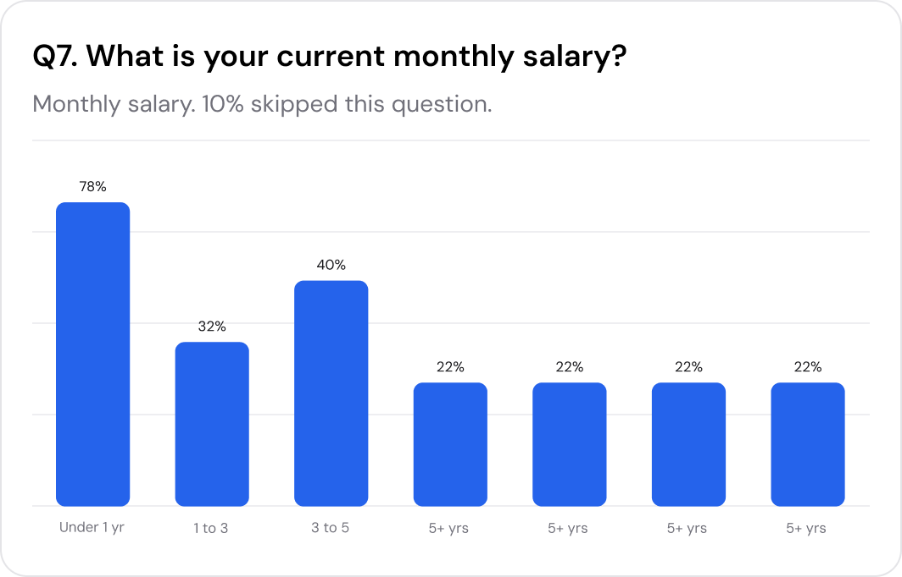
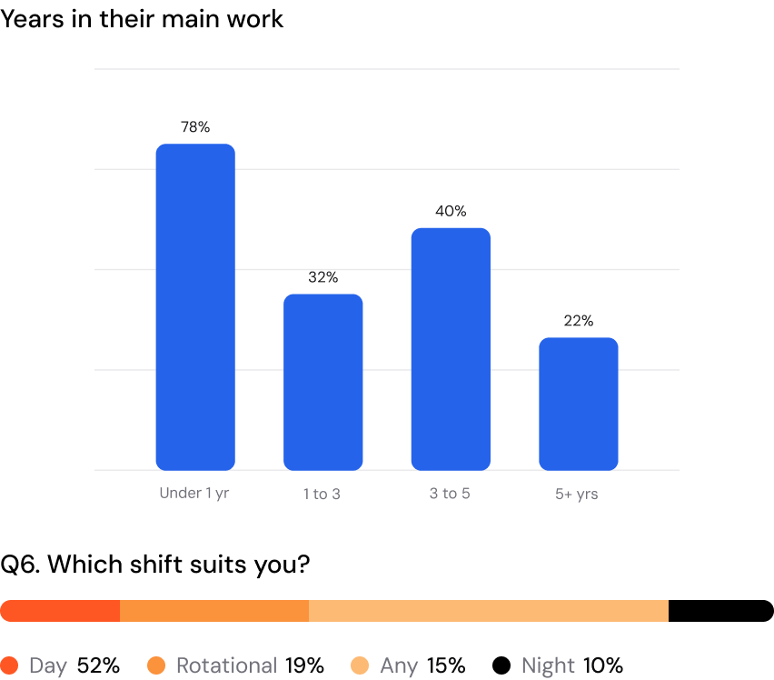

**Used in:** Desktop (1 of 80 screens), on the enrichment analytics view, to show answers to each question.

<Columns cols={2}>
  <Frame caption="Bar chart in a question card">
    
  </Frame>

  <Frame caption="Bar chart and stacked share bar">
    
  </Frame>
</Columns>

There are two chart types.

## 1. Bar chart

For answers with several options (experience, salary range).

| Property | Value |
| --- | --- |
| Bars | `#2563EB` (blue-600), top corners 6px, 44px wide |
| Value label | Above each bar, "78%", 12px `#18181B` |
| Category label | Under each bar, 12px `#71717A` |
| Grid | Horizontal lines only, `#E4E4E7`; no y-axis |
| Card | White, border `#E4E4E7`, 16px radius, 18px padding |
| Card title | "Q7. What is your current monthly salary?" 18px semibold |
| Card subtitle | e.g. "10% skipped this question." 14px `#71717A` |

```bash
npx shadcn@latest add chart card
```

```tsx
import { Bar, BarChart, CartesianGrid, LabelList, XAxis } from "recharts"
import { ChartContainer } from "@/components/ui/chart"
import { Card, CardHeader, CardTitle, CardDescription, CardContent } from "@/components/ui/card"

const data = [
  { label: "Under 1 yr", value: 78 },
  { label: "1 to 3", value: 32 },
  { label: "3 to 5", value: 40 },
  { label: "5+ yrs", value: 22 },
]
const config = { value: { label: "Candidates", color: "#2563EB" } }

<Card className="rounded-2xl p-[18px] shadow-none">
  <CardHeader className="p-0">
    <CardTitle className="text-lg font-semibold">Q7. What is your current monthly salary?</CardTitle>
    <CardDescription>Monthly salary. 10% skipped this question.</CardDescription>
  </CardHeader>
  <CardContent className="p-0 pt-4">
    <ChartContainer config={config} className="h-[220px] w-full">
      <BarChart data={data} margin={{ top: 20 }}>
        <CartesianGrid vertical={false} stroke="#E4E4E7" />
        <XAxis dataKey="label" tickLine={false} axisLine={false} tick={{ fontSize: 12, fill: "#71717A" }} />
        <Bar dataKey="value" fill="var(--color-value)" radius={[6, 6, 0, 0]} barSize={44}>
          <LabelList dataKey="value" position="top" formatter={(v) => `${v}%`} className="fill-zinc-900 text-xs" />
        </Bar>
      </BarChart>
    </ChartContainer>
  </CardContent>
</Card>
```

## 2. Stacked share bar

For how answers split across a few options (shift preference). Built from divs, not Recharts.

| Property | Value |
| --- | --- |
| Bar | 12px tall, fully rounded ends, segments side by side with no gap |
| Segment colours (in order) | `#FF5723` → `#FB923C` → `#FDBA74` → `#000000` |
| Legend | 10px dot + label 12px `#71717A` + value 12px medium `#09090B` |
| Title | "Q6. Which shift suits you?" 14px medium |

```tsx
const shifts = [
  { label: "Day", value: 52, color: "#FF5723" },
  { label: "Rotational", value: 19, color: "#FB923C" },
  { label: "Any", value: 15, color: "#FDBA74" },
  { label: "Night", value: 10, color: "#000000" },
]

<div className="grid gap-3">
  <p className="text-sm font-medium">Q6. Which shift suits you?</p>
  <div className="flex h-3 overflow-hidden rounded-full">
    {shifts.map((s) => <div key={s.label} style={{ width: `${s.value}%`, background: s.color }} />)}
  </div>
  <div className="flex flex-wrap gap-4 text-xs">
    {shifts.map((s) => (
      <span key={s.label} className="flex items-center gap-1.5">
        <span className="size-2.5 rounded-full" style={{ background: s.color }} />
        <span className="text-muted-foreground">{s.label}</span>
        <span className="font-medium text-zinc-950">{s.value}%</span>
      </span>
    ))}
  </div>
</div>
```

<Note>
  Charts show **percentages of candidates who answered**. Always say how many skipped the question in the card subtitle.
</Note>
