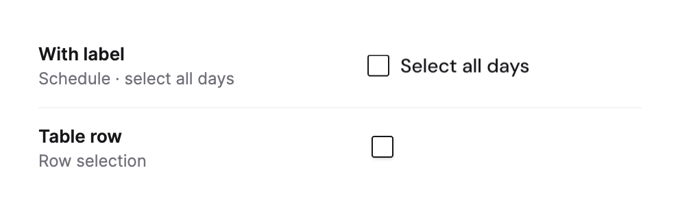

**Used in:** Desktop (12 of 80 screens). Not used on mobile.

<Frame caption="Real checkboxes from the desktop screens">
  
</Frame>

| Use | Spec |
| --- | --- |
| With label | 16px box, `#18181B` border, 2px radius; label 14px medium, 8px gap |
| Table row | Same box, no visible label (add `aria-label`) |
| In a menu | Inside the filter menu (see [Dropdown Menu](/product-design/dropdown-menu)) |

Checked state uses `bg-primary`.

## Install

```bash
npx shadcn@latest add checkbox label
```

## Usage

```tsx
import { Checkbox } from "@/components/ui/checkbox"
import { Label } from "@/components/ui/label"

<div className="flex items-center gap-2">
  <Checkbox id="all-days" />
  <Label htmlFor="all-days" className="text-sm font-medium">Select all days</Label>
</div>

{/* In a table */}
<Checkbox aria-label="Select row" />
```

<Note>
  The day selector in Schedule (Mon, Tue, Wed…) is built on Checkbox but shown as text chips; the selected day is highlighted in orange.
</Note>
