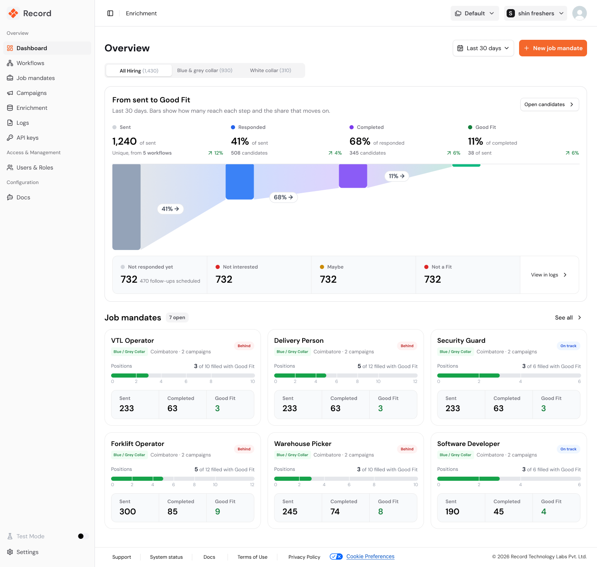
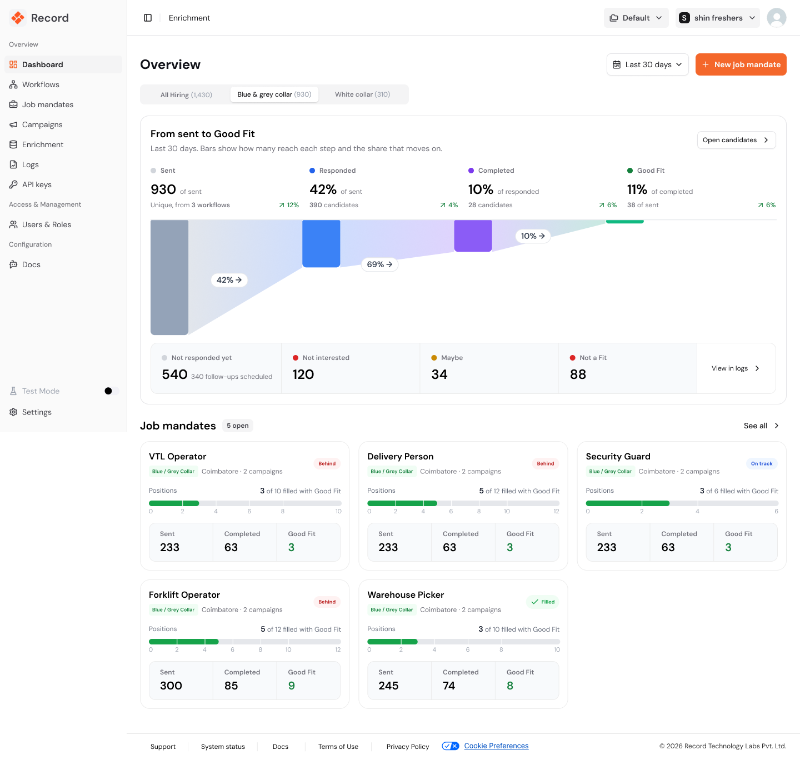
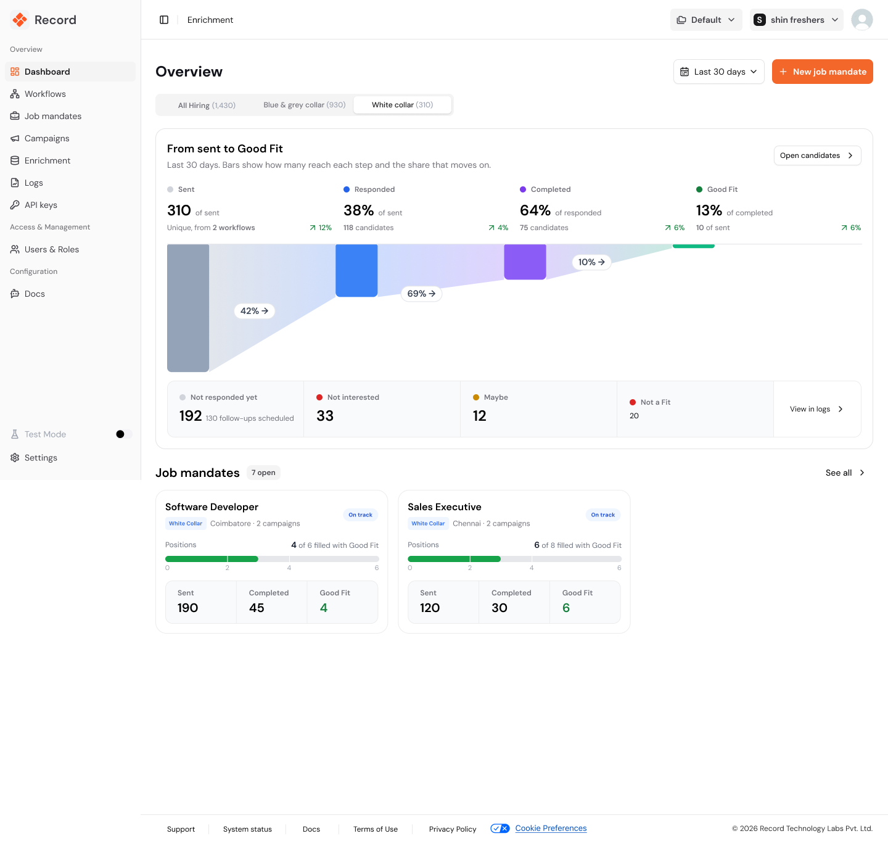

The first page a recruiter sees. It answers one question: how many candidates moved from **sent** to **Good Fit** in the selected period.

<Card title="Open in Figma" icon="figma" href="https://www.figma.com/design/cxBWcyyaRrn6J8GOOglw6t/Infra-Design---Record?node-id=83184-72666" horizontal>
  RCD-359 Dashboard and Analytics Metrics
</Card>

## Hiring type tabs

The page has three tabs. Each shows the same layout, filtered to that hiring type.

<Tabs>
  <Tab title="All hiring">
    
  </Tab>
  <Tab title="Blue & grey collar">
    
  </Tab>
  <Tab title="White collar">
    
  </Tab>
</Tabs>

Each tab label carries its count, for example **All Hiring (1,430)**.

## Sections on the page

| Section | What it shows |
| --- | --- |
| Header | Title **Overview**, **View logs**, date range (**Last 30 days**), primary button **New job mandate** |
| From sent to Good Fit | Four steps (Sent, Responded, Completed, Good Fit), each with a count, a percentage of the previous step and a change badge. Bars show how many reach each step; the arrows between show the share that moves on. |
| Outcome row | Not responded yet (with follow-ups scheduled), Not interested, Maybe, Not a Fit, and **View in logs** |
| Job mandates | Cards for open mandates with status (**Behind**, **On track**), positions filled with Good Fit, and Sent / Completed / Good Fit counts. **See all** opens the full list. |
| Initiate | Verifications sent directly to candidates: this month, completion rate, average time to result |
| Integrate | Verifications triggered through the API from your product |

## Components used

| Figma component | shadcn/ui | Used for |
| --- | --- | --- |
| Tabs | `tabs` | All hiring / Blue & grey collar / White collar |
| Badge | `badge` | Status (Behind, On track), change percentages, hiring type |
| Button | `button` | New job mandate, View logs, See all, View in logs |
| Breadcrumb | `breadcrumb` | Top bar |
| Sidebar | `sidebar` | App navigation (see [Overview](/product-design/desktop/overview)) |

```bash
npx shadcn@latest add tabs badge button breadcrumb sidebar
```

<Tip>
  Funnel bars and the arrows between steps are custom. Build them with plain `div`s and the colour tokens; there is no shadcn/ui component for them.
</Tip>
