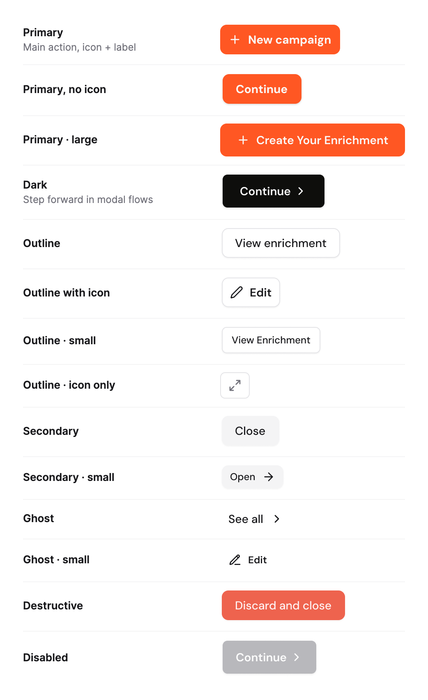
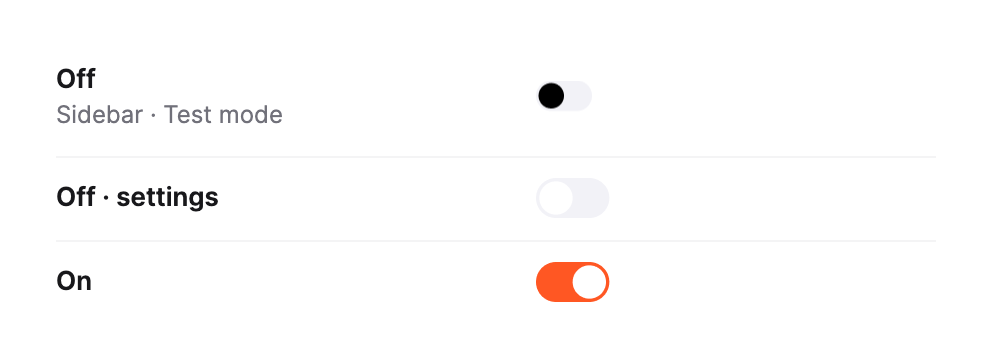
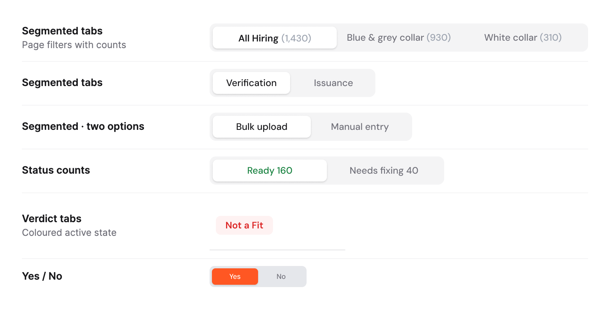
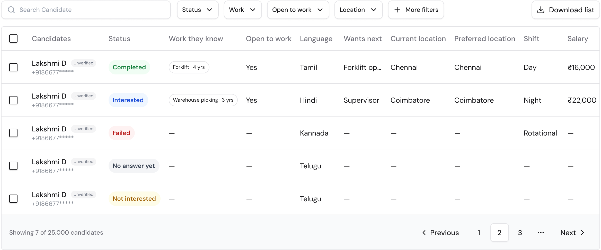
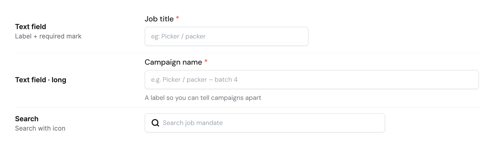
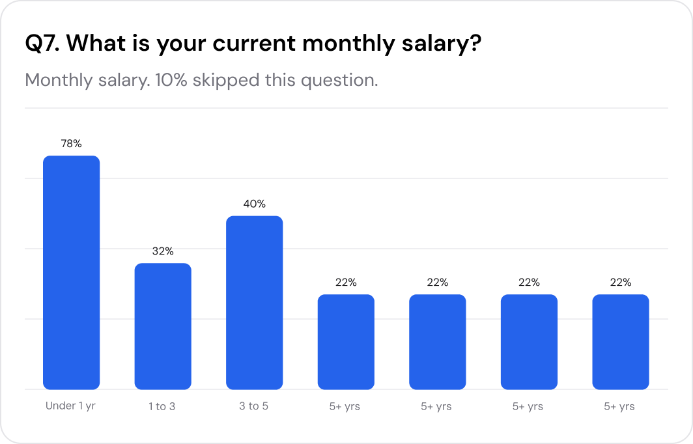

<Info>
  Desktop only. Screens are designed at **1440px** wide. Counts are from 80 desktop screens in Figma, visible layers only.
</Info>


## Install everything at once

```bash
npx shadcn@latest add button badge switch sidebar breadcrumb tabs dropdown-menu table progress input checkbox pagination toggle-group chart
```

Then apply the Record variants from each component page (Button and Badge especially).

## App shell

| Area | Components |
| --- | --- |
| Sidebar | [Sidebar](/product-design/sidebar), [Switch](/product-design/switch) (Test mode), [Badge](/product-design/badge) (Beta tag) |
| Top bar | [Breadcrumb](/product-design/breadcrumb), [Button](/product-design/button) |
| Page header | Title, date range, primary [Button](/product-design/button) |

## Buttons · 76 screens

Primary orange with an icon for the main action, outline for secondary actions, dark for stepping forward in modals.



[Button →](/product-design/button)

```tsx
<Button><Plus /> New campaign</Button>
<Button variant="outline"><Pencil /> Edit</Button>
```

## Badges · 71 screens

Soft, colour-coded status and type labels.


[Badge →](/product-design/badge)

```tsx
<Badge tone="success">Live</Badge>
<Badge tone="type">Enrichment</Badge>
```

## Sidebar · 65 screens


[Sidebar →](/product-design/sidebar)

## Switch · 66 screens



[Switch →](/product-design/switch)

## Breadcrumb · 65 screens


[Breadcrumb →](/product-design/breadcrumb)

## Tabs · 54 screens

Segmented tabs with counts, verdict tabs and Yes / No.



[Tabs →](/product-design/tabs)

## Dropdown Menu · 35 screens

Filters above tables and the menus they open.


[Dropdown Menu →](/product-design/dropdown-menu)

## Table · 33 screens

Filter bar, rows with status badges, and pagination.



[Table →](/product-design/table)

## Progress · 29 screens


[Progress →](/product-design/progress)

## Input · 17 screens



[Input →](/product-design/input)

## Checkbox · 12 screens


[Checkbox →](/product-design/checkbox)

## Pagination · 8 screens


[Pagination →](/product-design/pagination)

## Chart · 1 screen



[Chart →](/product-design/chart)

## Also used

| Component | Screens |
| --- | --- |
| [Toggle Group](/product-design/toggle-group) | 8 |

## Custom blocks

Not shadcn/ui. Build from the tokens.

| Block | Where |
| --- | --- |
| Tab Nav Links (Pro Blocks) | Page-level tabs inside an item (Overview, Configuration, Campaigns…) |
| Upgrade Button | Sidebar |
