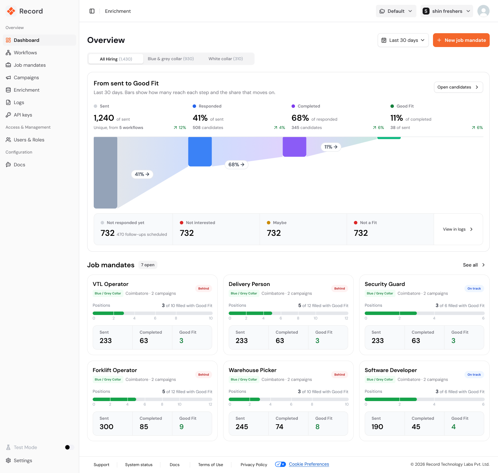

<Info>
  Desktop only. Screens are designed at **1440px** wide.
</Info>



## App shell

Every page uses the same shell.

| Area | shadcn/ui components |
| --- | --- |
| Sidebar (navigation, Get started checklist, Test mode) | `sidebar`, `radio-group`, `switch` |
| Top bar | `breadcrumb`, `button` |
| Page header (title, primary action) | `button` |

## Components in use

Counted across **80 desktop screens** in Figma.

| Component | shadcn/ui | Screens using it |
| --- | --- | --- |
| Button | `button` | 77 |
| Badge | `badge` | 72 |
| Switch | `switch` | 66 |
| Sidebar | `sidebar` | 65 |
| Breadcrumb | `breadcrumb` | 65 |
| Radio Group | `radio-group` | 57 |
| Tabs | `tabs` | 54 |
| Checkbox | `checkbox` | 37 |
| Table / Data Table | `table` | 35 |
| Progress | `progress` | 35 |
| Dropdown Menu | `dropdown-menu` | 35 |
| Input | `input` | 30 |
| Pagination | `pagination` | 25 |
| Toggle Group | `toggle-group` | 8 |
| Chart | `chart` | 4 |

```bash
npx shadcn@latest add button badge switch sidebar breadcrumb radio-group tabs checkbox table progress dropdown-menu input pagination toggle-group chart
```

### Custom blocks

These are not shadcn/ui components. Build them from the tokens.

| Block | Where |
| --- | --- |
| Tab Nav Links (Pro Blocks) | Page-level tab navigation |
| Upgrade Button | Sidebar |

<Tip>
  New screen? Check this list first. If a component you need isn't here, check with design before adding a new one.
</Tip>
