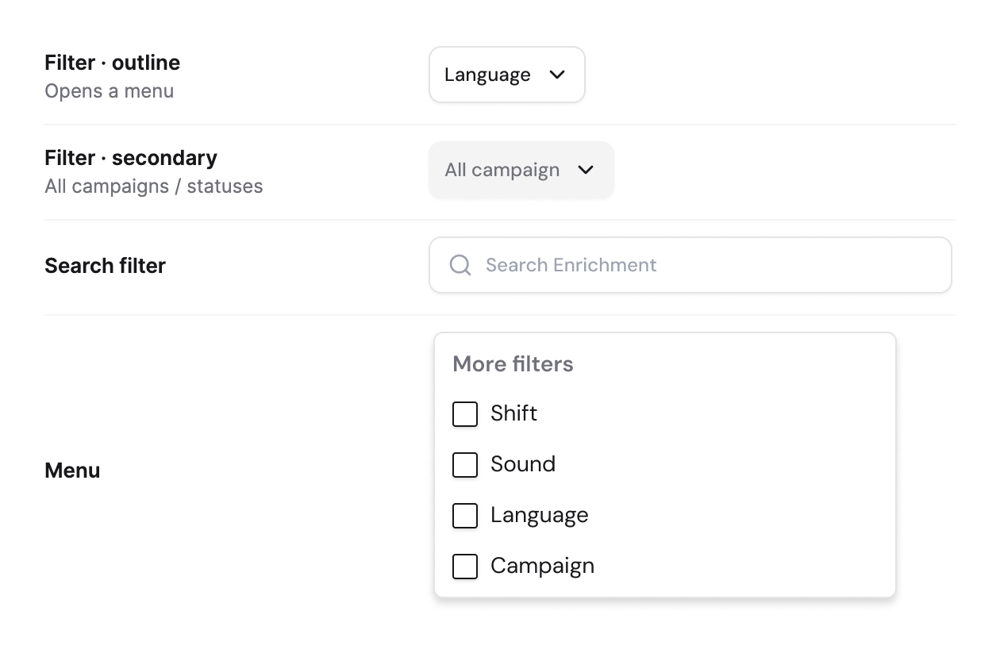

**Used in:** Desktop, mostly as **filters above tables**.

<Frame caption="Real filters and menu from the desktop screens">
  
</Frame>

| Part | Spec | Example |
| --- | --- | --- |
| Filter · outline | Outline button, `sm`, 36px high, 8px radius, 12px medium, chevron down | Language, Status, Verdict, Campaign |
| Filter · secondary | `#F4F4F5` background, `#71717A` text, 36px high, 8px radius, chevron down | All campaigns, All statuses |
| Search filter | Outline, search icon, `#9CA3AF` placeholder | Search candidate, Search state |
| Menu | White, border `#E4E4E7`, 6px radius; label 14px semibold `#71717A`; checkbox items | More filters: Shift, Sound, Language, Campaign |

## Install

```bash
npx shadcn@latest add dropdown-menu button
```

## Usage

```tsx
import {
  DropdownMenu, DropdownMenuTrigger, DropdownMenuContent,
  DropdownMenuLabel, DropdownMenuCheckboxItem,
} from "@/components/ui/dropdown-menu"

<DropdownMenu>
  <DropdownMenuTrigger asChild>
    <Button variant="outline" size="sm" className="h-9 rounded-lg">
      Language <ChevronDown />
    </Button>
  </DropdownMenuTrigger>
  <DropdownMenuContent align="start">
    <DropdownMenuLabel className="text-muted-foreground">More filters</DropdownMenuLabel>
    <DropdownMenuCheckboxItem checked={shift} onCheckedChange={setShift}>Shift</DropdownMenuCheckboxItem>
    <DropdownMenuCheckboxItem checked={sound} onCheckedChange={setSound}>Sound</DropdownMenuCheckboxItem>
  </DropdownMenuContent>
</DropdownMenu>

{/* Secondary filter */}
<Button variant="secondary" size="sm" className="h-9 rounded-lg text-muted-foreground">
  All campaigns <ChevronDown />
</Button>
```

<Tip>
  Row three-dot menus in tables must include an **Edit** option.
</Tip>
