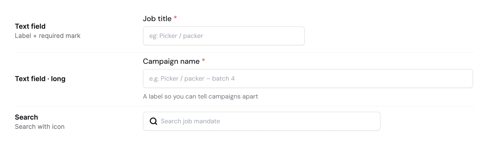

**Used in:** Desktop (17 of 80 screens)

<Frame caption="Real inputs from the desktop screens">
  
</Frame>

| Style | Spec | Used for |
| --- | --- | --- |
| Text field | Label 14px medium with red `*` for required; field 36px high, 6px radius, border `#E4E4E7`; placeholder `#9CA3AF` | Job title, Company name, Campaign name |
| Search | 36px high, search icon on the left, placeholder `#9CA3AF`, 12px text | Search job mandate, Search candidate |

## Install

```bash
npx shadcn@latest add input label
```

## Usage

```tsx
import { Input } from "@/components/ui/input"
import { Label } from "@/components/ui/label"

{/* Text field */}
<div className="grid gap-1.5">
  <Label htmlFor="job-title" className="text-sm font-medium">
    Job title <span className="text-red-500">*</span>
  </Label>
  <Input id="job-title" placeholder="eg. Picker / packer" className="h-9 placeholder:text-gray-400" required />
</div>

{/* Search */}
<div className="relative">
  <Search className="absolute left-3 top-1/2 size-4 -translate-y-1/2 text-gray-400" />
  <Input placeholder="Search job mandate" className="h-9 pl-9 text-xs placeholder:text-gray-400" />
</div>
```

Focus ring: `ring-ring` (`#FF5723`).
