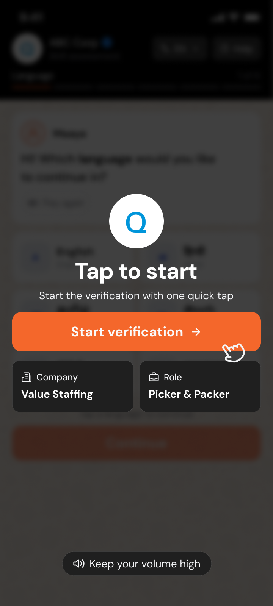
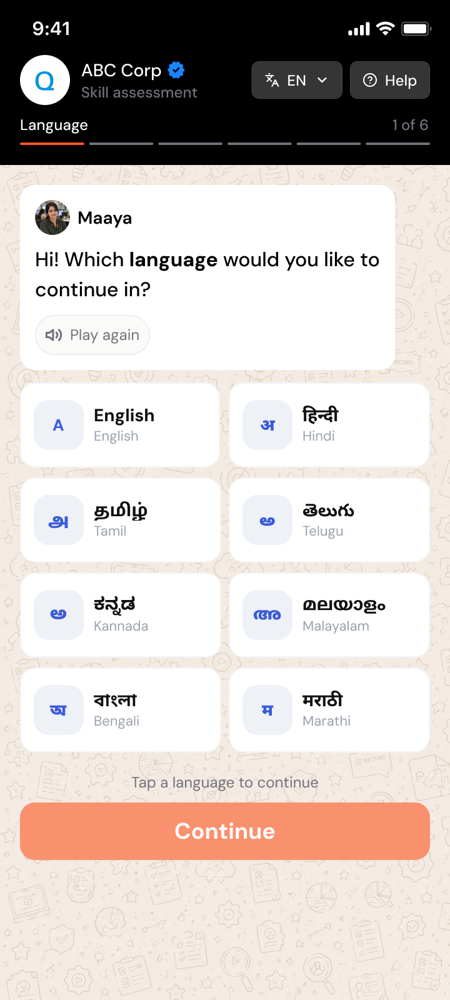
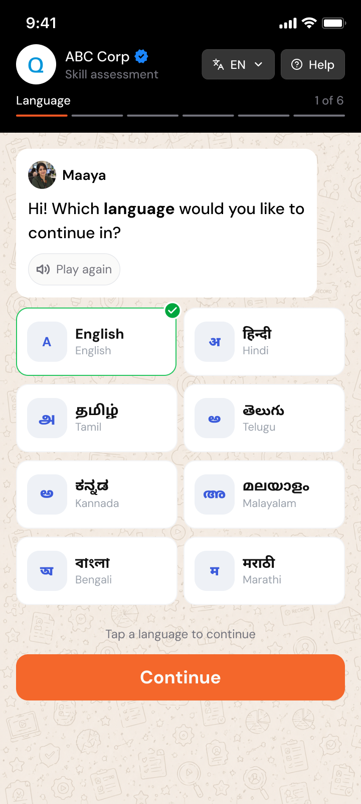
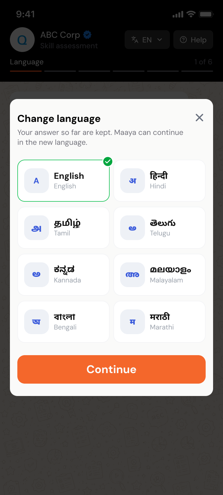
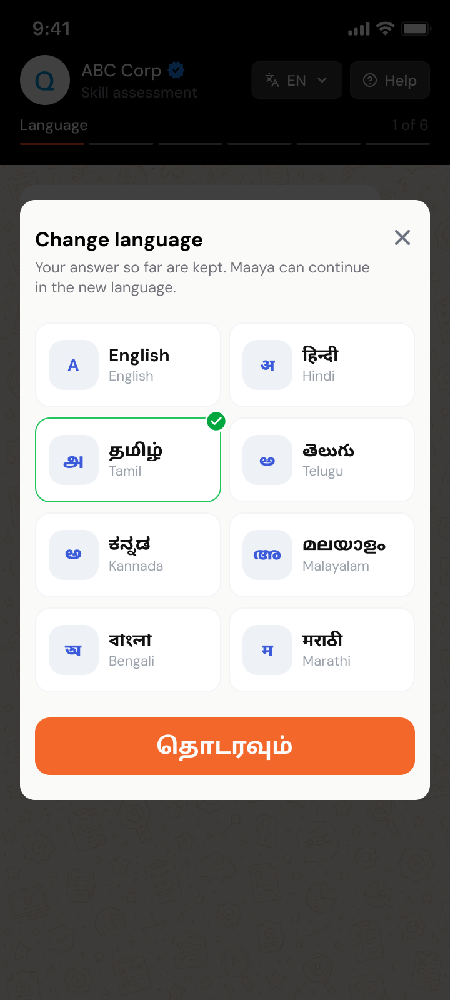
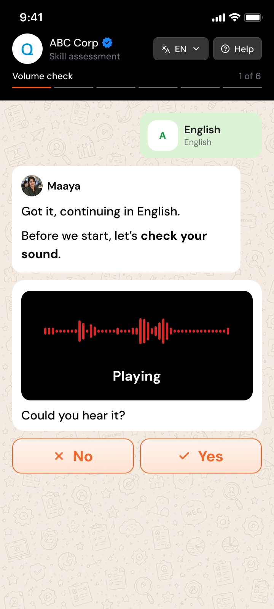
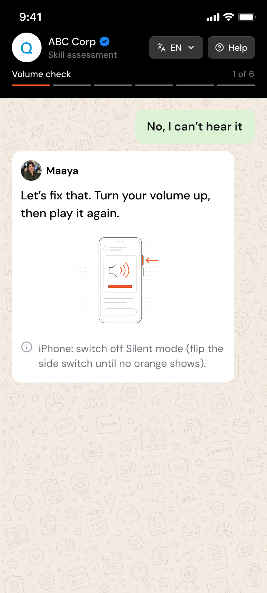
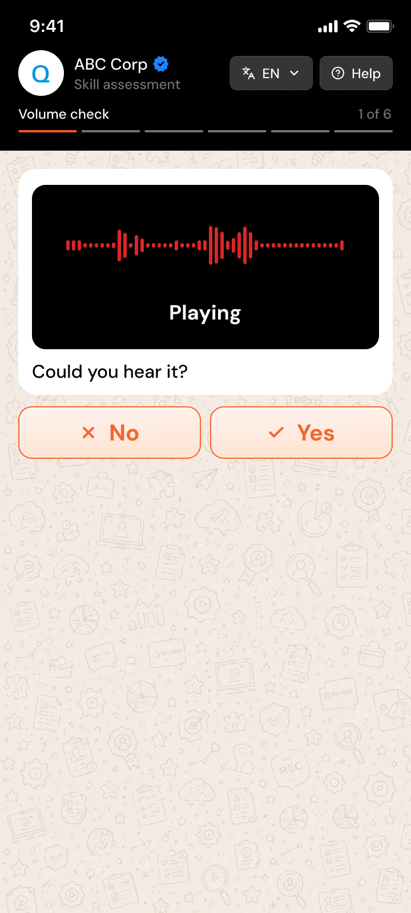
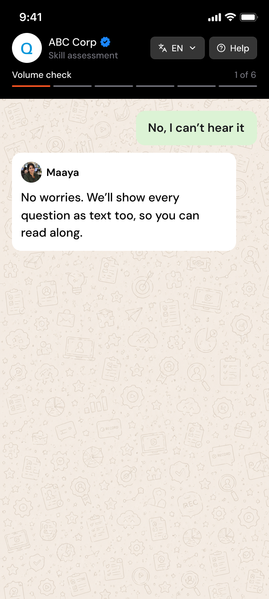

**Stage 1 of 6.** The progress label reads **Language · 1 of 6**, then **Volume check · 1 of 6**.

<Card title="Open in Figma" icon="figma" href="https://www.figma.com/design/cxBWcyyaRrn6J8GOOglw6t/Infra-Design---Record?node-id=83103-160615" horizontal>
  RCD-346 App UX improvements v3, New design flow
</Card>

## Pick a language

<Columns cols={3}>
  <Frame caption="1. Tap to start">
    
  </Frame>
  <Frame caption="2. Choose language">
    
  </Frame>
  <Frame caption="3. Language selected">
    
  </Frame>
</Columns>

- Maaya asks: *Hi! Which language would you like to continue in?* The audio reads out every language name.
- Languages: English, Tamil, Kannada, Bengali, Hindi, Telugu, Malayalam, Marathi. Each option shows a letter in its own script, the native name and the English name.
- Helper text under the list: *Tap a language to continue*.

### Variation: Continue button in the chosen language

Tapping a language changes only the **Continue** button into that language (for example **தொடரவும்** for Tamil, **जारी रखें** for Hindi). It confirms the choice in a script the candidate can read before they tap.

<Columns cols={3}>
  <Frame caption="Before selecting">
    
  </Frame>
  <Frame caption="After selecting">
    
  </Frame>
</Columns>

<Warning>
  **Open question from design:** should languages be ordered by the job's state (Tamil first for a Chennai job)?
</Warning>

## Check the sound

<Columns cols={3}>
  <Frame caption="4. Could you hear it?">
    
  </Frame>
  <Frame caption="5. If No: how to fix">
    
  </Frame>
  <Frame caption="6. Ask again">
    
  </Frame>
</Columns>

<Columns cols={3}>
  <Frame caption="7. Still No: read along">
    
  </Frame>
</Columns>

| Step | Maaya says | Candidate can |
| --- | --- | --- |
| Sound check | *Got it, continuing in English. Before we start, let's check your sound.* Audio plays, then *Could you hear it?* | **Yes** (go to stage 2) or **No** |
| How to fix | *Let's fix that. Turn your volume up, then play it again.* Plus an iPhone tip: switch off Silent mode. | **Play again** |
| Ask again | *Could you hear it?* | **Yes** or **No** |
| Read along | *No worries. We'll show every question as text too, so you can read along.* | Continue without audio |

## Components used

| Figma component | shadcn/ui | Used for |
| --- | --- | --- |
| Button | `button` | Continue, Yes, No, Play again |
| Checkbox | `checkbox` | I agree to the Terms & Conditions |

<Tip>
  The language options and chat bubbles are custom. Build them with the [colour](/product-design/colors), [spacing](/product-design/spacing) and [radius](/product-design/radius) tokens.
</Tip>
