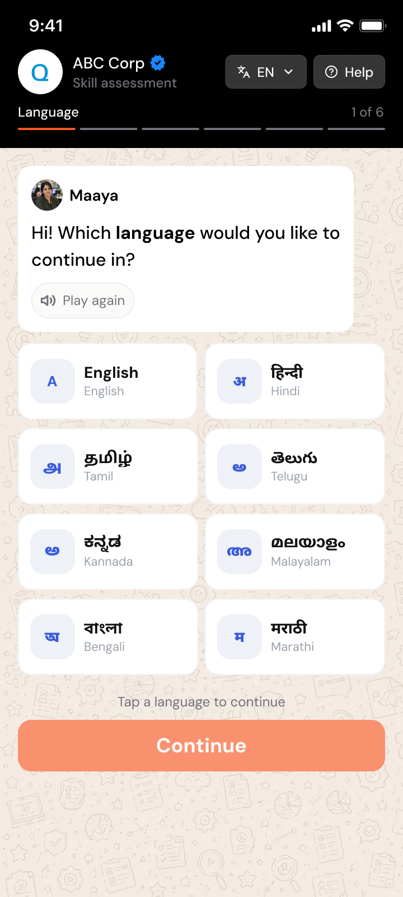
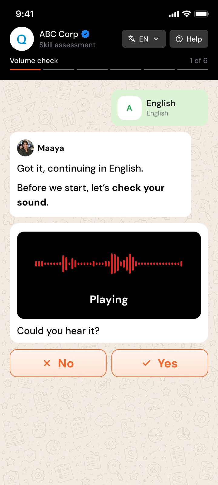
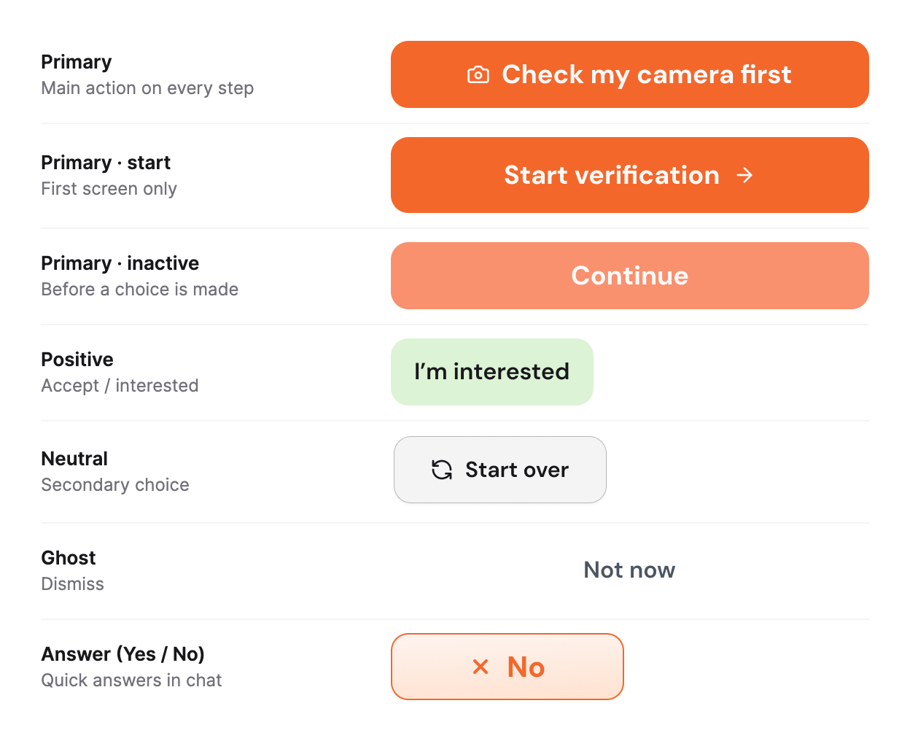
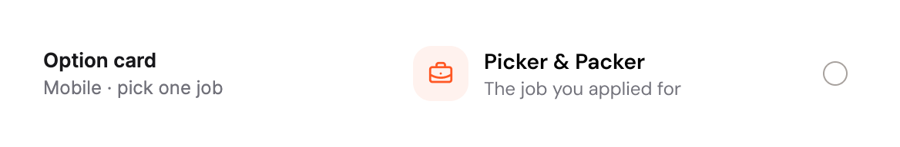

<Info>
  Mobile only. Screens are designed at **360 × 800**. Counts are from 58 mobile screens in Figma, visible layers only.
</Info>

<Columns cols={2}>
  <Frame caption="Language selection">
    
  </Frame>

  <Frame caption="Sound check">
    
  </Frame>
</Columns>

## Install everything at once

```bash
npx shadcn@latest add button radio-group progress
```

Then add the mobile sizes and variants from [Button](/product-design/button) (`mobile`, `mobile-lg`, `positive`, `neutral`, `answer`).

## Buttons · 48 screens

Full-width, 46px tall, 12px corners. Orange for the main action, green for accepting, grey for alternatives, and the outlined Yes / No for quick answers.



[Button →](/product-design/button)

```tsx
<Button size="mobile"><Camera /> Check my camera first</Button>
<Button variant="positive" size="mobile">I’m interested</Button>
<Button variant="neutral" size="mobile"><RotateCcw /> Start over</Button>
<Button variant="answer" size="mobile"><X /> No</Button>
```

## Option card (Radio Group) · 3 screens

Pick one option, for example the job the candidate is working in.



[Radio Group →](/product-design/radio-group)

## Progress · 1 screen

Green progress bar. See [Progress →](/product-design/progress).

## Custom blocks

Not shadcn/ui. Build from the [colour](/product-design/colors), [spacing](/product-design/spacing) and [radius](/product-design/radius) tokens.

| Block | Where |
| --- | --- |
| Header | Client logo and name, Skill assessment, language, Help |
| Stage progress | "Language · 1 of 6" bar across every screen |
| Chat bubbles | Maaya's messages with Play again |
| Language options | Script letter + native name + English name |
| Recording controls | Voice and video answers |
