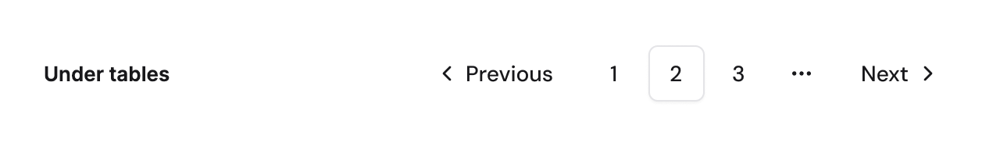

**Used in:** Desktop (8 of 80 screens), under candidate and campaign tables.

<Frame caption="Real pagination from the desktop screens">
  
</Frame>

| Part | Spec |
| --- | --- |
| Previous / Next | Ghost, 36px high, 14px medium, chevron icon |
| Page number | 36 × 36px, 6px radius |
| Current page | Outlined, border `#E4E4E7` |
| Ellipsis | Between distant pages |

## Install

```bash
npx shadcn@latest add pagination
```

## Usage

```tsx
import { Pagination, PaginationContent, PaginationItem, PaginationLink, PaginationPrevious, PaginationNext, PaginationEllipsis } from "@/components/ui/pagination"

<Pagination className="justify-end">
  <PaginationContent>
    <PaginationItem><PaginationPrevious href="#" /></PaginationItem>
    <PaginationItem><PaginationLink href="#">1</PaginationLink></PaginationItem>
    <PaginationItem><PaginationLink href="#" isActive>2</PaginationLink></PaginationItem>
    <PaginationItem><PaginationLink href="#">3</PaginationLink></PaginationItem>
    <PaginationItem><PaginationEllipsis /></PaginationItem>
    <PaginationItem><PaginationNext href="#" /></PaginationItem>
  </PaginationContent>
</Pagination>
```
