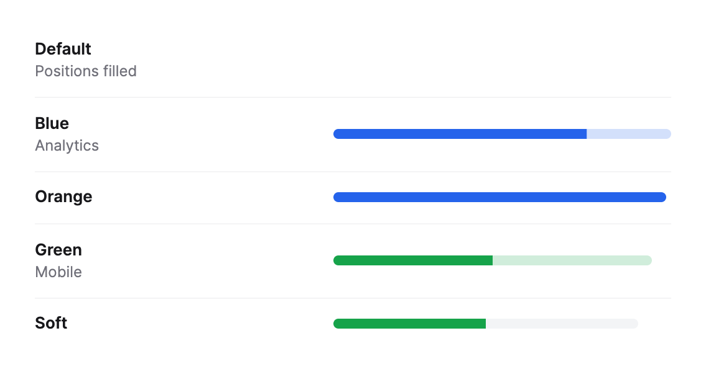

**Used in:** Desktop (29 of 80 screens) · Mobile (1 of 58 screens)

<Frame caption="Real progress bars from the screens">
  
</Frame>

| Colour | Indicator | Used for |
| --- | --- | --- |
| Default | `#18181B` (zinc-900) | Positions filled on job mandate cards, campaign progress |
| Blue | `#2563EB` (blue-600) | Analytics breakdowns |
| Orange | `#FF5723` (`bg-primary`) | Highlighted or top value |
| Green | `#16A34A` (green-600) | Mobile progress |
| Soft | `#F3F4F6` / `#E2E8F0` | Low-emphasis rows |

All bars are **8px high** (a few analytics bars are 6px or 12px) and fully rounded.

## Install

```bash
npx shadcn@latest add progress
```

## Usage

```tsx
import { Progress } from "@/components/ui/progress"

<Progress value={30} className="h-2 [&>div]:bg-zinc-900" />
<Progress value={75} className="h-2 [&>div]:bg-blue-600" />
<Progress value={50} className="h-2 [&>div]:bg-primary" />
<Progress value={50} className="h-2 [&>div]:bg-green-600" />
```

The Figma kit has fixed steps (0, 25, 50, 75, 100%). In code, pass the real value.
