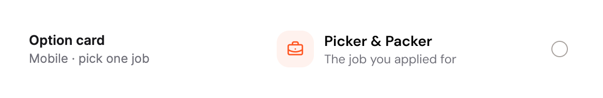

**Used in:** Mobile (3 of 58 screens). Not used on desktop.

<Frame caption="Real option card from the mobile screens">
  
</Frame>

Candidates pick one option, for example which job they're currently working in.

| Part | Spec |
| --- | --- |
| Icon | Orange icon on a light orange tile |
| Title | 14px semibold, `#18181B` |
| Subtitle | 12px regular, `#71717A` |
| Radio | 16px circle on the right |
| Row | Full width (288px on a 360px screen), 36px tall |

## Install

```bash
npx shadcn@latest add radio-group label
```

## Usage

```tsx
import { RadioGroup, RadioGroupItem } from "@/components/ui/radio-group"
import { Label } from "@/components/ui/label"

<RadioGroup value={job} onValueChange={setJob} className="gap-3">
  <Label htmlFor="picker" className="flex items-center gap-3">
    <span className="flex size-8 items-center justify-center rounded-md bg-orange-50 text-primary"><Briefcase className="size-4" /></span>
    <span className="grid flex-1 gap-0.5">
      <span className="text-sm font-semibold">Picker & Packer</span>
      <span className="text-xs text-muted-foreground">The job you applied for</span>
    </span>
    <RadioGroupItem value="picker" id="picker" />
  </Label>
</RadioGroup>
```
