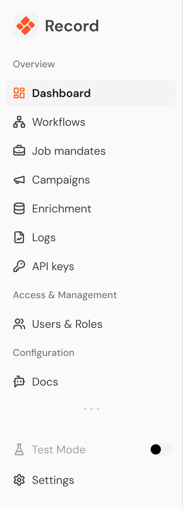

**Used in:** Desktop (65 of 80 screens), on every page of the app.

<Frame caption="The sidebar as designed (middle trimmed)">
  
</Frame>

## Structure

| Part | Contents |
| --- | --- |
| Header | Record logo in a 32px tile + "Record" |
| Group: **Overview** | Dashboard, Workflows, Job mandates, Campaigns, Enrichment, Logs, API keys |
| Group: **Access & Management** | Users & Roles |
| Group: **Configuration** | Docs |
| Footer | Test mode [Switch](/product-design/switch), Settings |

## Spec

| Property | Value |
| --- | --- |
| Width | 228px |
| Background | `#FAFAFA` (zinc-50), right border `#E4E4E7` |
| Padding | 8px |
| Logo tile | 32 × 32px, `#F3F4F6`, 8px radius; name 20px semibold `#3F3F46` |
| Group label | 12px medium, `#3F3F46` at reduced opacity, 32px tall |
| Menu item | 32px tall, 8px padding, 6px radius, 8px gap between icon and text, 4px between items |
| Item text | 14px regular, `#3F3F46`; icon 16px Lucide, `#3F3F46` |
| **Active item** | Background `#F4F4F5`, text 14px **semibold** `#18181B`, icon **orange** `#FF5723` |
| Test mode | Label 14px `#9CA3AF`, small switch (28 × 15) |

## Install

```bash
npx shadcn@latest add sidebar switch
```

## Usage

```tsx components/app-sidebar.tsx
import {
  Sidebar, SidebarHeader, SidebarContent, SidebarFooter,
  SidebarGroup, SidebarGroupLabel, SidebarMenu, SidebarMenuItem, SidebarMenuButton,
} from "@/components/ui/sidebar"
import { Switch } from "@/components/ui/switch"
import { LayoutGrid, Workflow, Briefcase, Megaphone, Database, FileText, KeyRound, Users, BookOpen, FlaskConical, Settings } from "lucide-react"

const groups = [
  { label: "Overview", items: [
    { title: "Dashboard", href: "/dashboard", icon: LayoutGrid },
    { title: "Workflows", href: "/workflows", icon: Workflow },
    { title: "Job mandates", href: "/job-mandates", icon: Briefcase },
    { title: "Campaigns", href: "/campaigns", icon: Megaphone },
    { title: "Enrichment", href: "/enrichment", icon: Database },
    { title: "Logs", href: "/logs", icon: FileText },
    { title: "API keys", href: "/api-keys", icon: KeyRound },
  ]},
  { label: "Access & Management", items: [{ title: "Users & Roles", href: "/users", icon: Users }] },
  { label: "Configuration", items: [{ title: "Docs", href: "/docs", icon: BookOpen }] },
]

export function AppSidebar({ pathname }) {
  return (
    <Sidebar className="w-[228px] border-r bg-zinc-50">
      <SidebarHeader className="p-2">
        <div className="flex items-center gap-2 p-2">
          <span className="flex size-8 items-center justify-center rounded-lg bg-gray-100"><Logo /></span>
          <span className="text-xl font-semibold text-zinc-700">Record</span>
        </div>
      </SidebarHeader>

      <SidebarContent className="px-2">
        {groups.map((g) => (
          <SidebarGroup key={g.label} className="p-0">
            <SidebarGroupLabel className="h-8 text-xs font-medium text-zinc-700/70">{g.label}</SidebarGroupLabel>
            <SidebarMenu className="gap-1">
              {g.items.map((item) => {
                const active = pathname.startsWith(item.href)
                return (
                  <SidebarMenuItem key={item.title}>
                    <SidebarMenuButton
                      asChild
                      isActive={active}
                      className="h-8 rounded-md text-sm text-zinc-700 data-[active=true]:bg-zinc-100 data-[active=true]:font-semibold data-[active=true]:text-zinc-900 [&[data-active=true]>svg]:text-primary"
                    >
                      <a href={item.href}><item.icon /> {item.title}</a>
                    </SidebarMenuButton>
                  </SidebarMenuItem>
                )
              })}
            </SidebarMenu>
          </SidebarGroup>
        ))}
      </SidebarContent>

      <SidebarFooter className="px-2 pb-5">
        <div className="flex h-8 items-center gap-2 px-2 text-sm text-gray-400">
          <FlaskConical className="size-4" /> Test mode
          <Switch className="ml-auto h-[15px] w-7" />
        </div>
        <SidebarMenuButton className="h-8 text-sm text-zinc-700"><Settings /> Settings</SidebarMenuButton>
      </SidebarFooter>
    </Sidebar>
  )
}
```

<Tip>
  Only the **active** item gets the orange icon. Every other icon stays `#3F3F46`.
</Tip>
