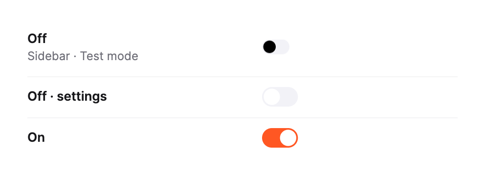

**Used in:** Desktop (66 of 80 screens): **Test mode** in the sidebar, and on/off settings in setup steps.

<Frame caption="Real switches from the desktop screens">
  
</Frame>

| State | Track | Thumb |
| --- | --- | --- |
| Off | `#F2F2F7` | white |
| On | `#FF5723` (`bg-primary`) | white |

| Size | Height | Where |
| --- | --- | --- |
| Small | 15px | Sidebar Test mode |
| Default | 20px | Settings in setup steps |

In Figma this is the `toggle` component (states **Default** = off, **Right** = on).

## Install

```bash
npx shadcn@latest add switch label
```

## Usage

```tsx
import { Switch } from "@/components/ui/switch"
import { Label } from "@/components/ui/label"

<div className="flex items-center gap-2">
  <Switch
    id="test-mode"
    checked={testMode}
    onCheckedChange={setTestMode}
    className="data-[state=unchecked]:bg-[#F2F2F7] data-[state=checked]:bg-primary"
  />
  <Label htmlFor="test-mode">Test mode</Label>
</div>
```

<Warning>
  One setup screen shows the switch on in blue (`#3B82F6`). Use orange (`bg-primary`) everywhere.
</Warning>
