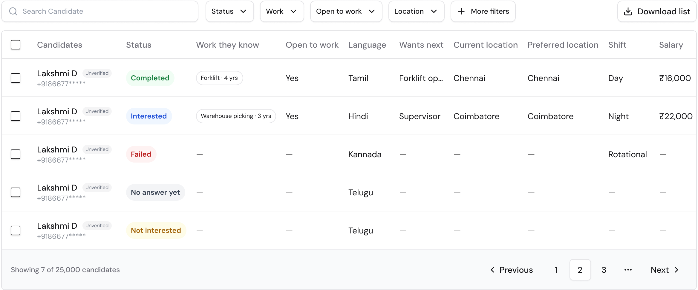

**Used in:** Desktop

A Record table is always the same block: **filter bar → table → pagination**.

<Frame caption="The candidate table as designed">
  
</Frame>

## Spec

| Part | Value |
| --- | --- |
| Container | White, no outer border; rows separated by a 1px bottom border `#E4E4E7` |
| Header row | 48px tall, 14px medium `#71717A`, bottom border `#E4E4E7` |
| Body row | 64px tall, cell padding 8px × 16px |
| Primary cell | Name 14px medium `#18181B`; second line 12px `#8A8F98` (e.g. masked phone) |
| Other cells | 14px regular `#18181B`; empty value shown as `—` |
| Select column | [Checkbox](/product-design/checkbox) in header and every row |
| Status column | [Badge](/product-design/badge) `shape="pill"` (Completed, Interested, Failed…) |
| Skill column | [Badge](/product-design/badge) `tone="outline" shape="chip"` |
| Row actions | Outline `sm` [Button](/product-design/button) and a three-dot [Dropdown Menu](/product-design/dropdown-menu) |
| Filter bar | Search [Input](/product-design/input), filter [Dropdown Menus](/product-design/dropdown-menu), **More filters**, **Download list** on the right |
| Footer | "Showing 7 of 25,000 candidates" (14px `#71717A`) + [Pagination](/product-design/pagination) |

Wide tables scroll horizontally; keep the select and name columns visible.

## Install

```bash
npx shadcn@latest add table checkbox badge input dropdown-menu pagination button
```

## Usage

```tsx
import { Table, TableHeader, TableBody, TableRow, TableHead, TableCell } from "@/components/ui/table"
import { Checkbox } from "@/components/ui/checkbox"
import { Badge } from "@/components/ui/badge"

const statusTone = { Completed: "success", Interested: "info", Failed: "danger", "No answer yet": "muted", "Not interested": "warning" }

<Table>
  <TableHeader>
    <TableRow className="h-12">
      <TableHead className="w-10"><Checkbox aria-label="Select all" /></TableHead>
      <TableHead className="text-sm font-medium text-muted-foreground">Candidates</TableHead>
      <TableHead className="text-sm font-medium text-muted-foreground">Status</TableHead>
      <TableHead className="text-sm font-medium text-muted-foreground">Work they know</TableHead>
      <TableHead className="text-sm font-medium text-muted-foreground">Language</TableHead>
    </TableRow>
  </TableHeader>
  <TableBody>
    {candidates.map((c) => (
      <TableRow key={c.id} className="h-16">
        <TableCell className="px-4"><Checkbox aria-label={`Select ${c.name}`} /></TableCell>
        <TableCell className="px-4">
          <div className="text-sm font-medium">{c.name}</div>
          <div className="text-xs text-[#8A8F98]">{c.phoneMasked}</div>
        </TableCell>
        <TableCell className="px-4"><Badge tone={statusTone[c.status]} shape="pill">{c.status}</Badge></TableCell>
        <TableCell className="px-4">{c.skill ? <Badge tone="outline" shape="chip">{c.skill}</Badge> : "—"}</TableCell>
        <TableCell className="px-4 text-sm">{c.language}</TableCell>
      </TableRow>
    ))}
  </TableBody>
</Table>
```

For sorting, filtering and selection, wrap this in the shadcn **Data Table** pattern (TanStack Table): see the [shadcn data table guide](https://ui.shadcn.com/docs/components/data-table).

<Tip>
  Mask phone numbers in lists (`+9186677*****`). Show the full number only on the candidate's detail view.
</Tip>
