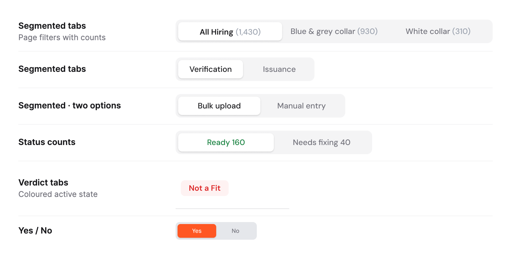

**Used in:** Desktop

<Frame caption="Real tabs from the desktop screens">
  
</Frame>

## Styles

| Style | List | Active trigger | Inactive trigger | Used for |
| --- | --- | --- | --- | --- |
| Segmented | `#F4F4F5`, 36px high, 8px radius | white, `#18181B`, 12px medium, 6px radius | `#71717A` | Hiring type (with counts), Manual entry / Bulk upload, Current location / States |
| Status counts | Same as segmented | Count in green `#16A34A` | `#71717A` | "Ready 160" on upload review |
| Verdict | Same as segmented | Coloured: red-50 / red-600 (Not a Fit), yellow-50 / yellow-600 (Maybe), stone-100 / stone-600 (Review) | `#71717A` | Candidate verdict |
| Yes / No | Same as segmented | `#FF5723`, white text | `#71717A` | Yes / No question setting |

## Install

```bash
npx shadcn@latest add tabs
```

## Usage

```tsx
import { Tabs, TabsList, TabsTrigger, TabsContent } from "@/components/ui/tabs"

{/* Segmented, with counts */}
<Tabs defaultValue="all">
  <TabsList className="h-9 rounded-lg bg-muted p-1">
    <TabsTrigger value="all" className="rounded-md text-xs font-medium data-[state=active]:bg-background">
      All Hiring <span className="ml-1 text-muted-foreground">1,430</span>
    </TabsTrigger>
    <TabsTrigger value="bg" className="rounded-md text-xs font-medium">Blue & grey collar <span className="ml-1 text-muted-foreground">930</span></TabsTrigger>
    <TabsTrigger value="wc" className="rounded-md text-xs font-medium">White collar <span className="ml-1 text-muted-foreground">310</span></TabsTrigger>
  </TabsList>
</Tabs>

{/* Yes / No */}
<TabsList className="h-9 rounded-lg bg-muted p-1">
  <TabsTrigger value="yes" className="rounded-md text-xs data-[state=active]:bg-primary data-[state=active]:text-primary-foreground">Yes</TabsTrigger>
  <TabsTrigger value="no" className="rounded-md text-xs">No</TabsTrigger>
</TabsList>

{/* Verdict: set the active colour per value */}
<TabsTrigger value="not-fit" className="data-[state=active]:bg-red-50 data-[state=active]:text-red-600 font-semibold">Not a Fit</TabsTrigger>
<TabsTrigger value="maybe" className="data-[state=active]:bg-yellow-50 data-[state=active]:text-yellow-600 font-semibold">Maybe</TabsTrigger>
```

<Note>
  Page-level navigation (Overview, Configuration, Campaigns, Candidates, Analytics, API) is **Tab Nav Links**, a custom block from Pro Blocks, not this component.
</Note>
